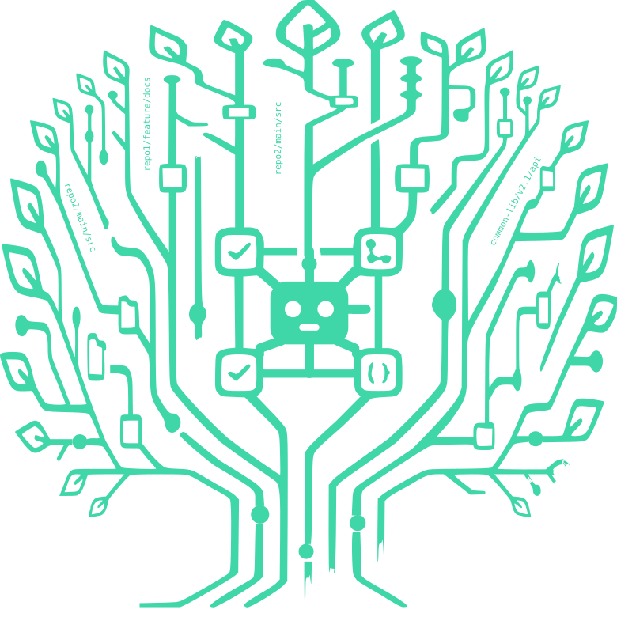
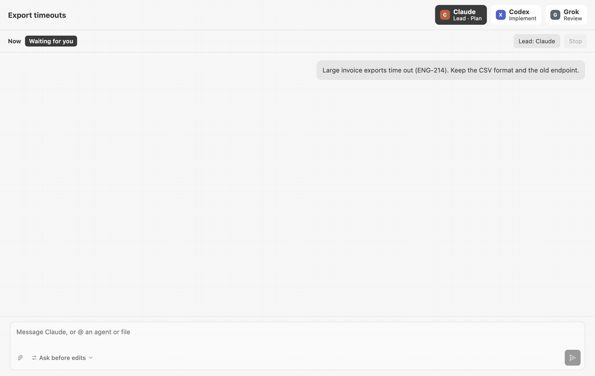
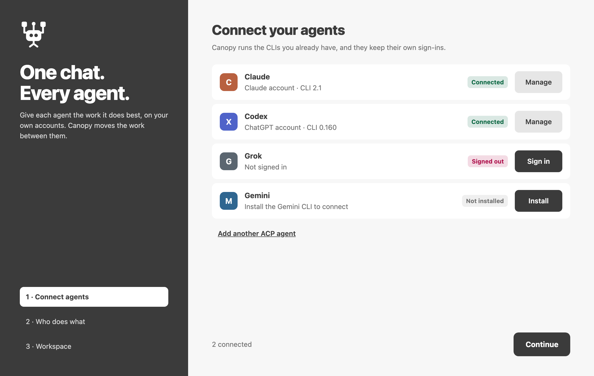
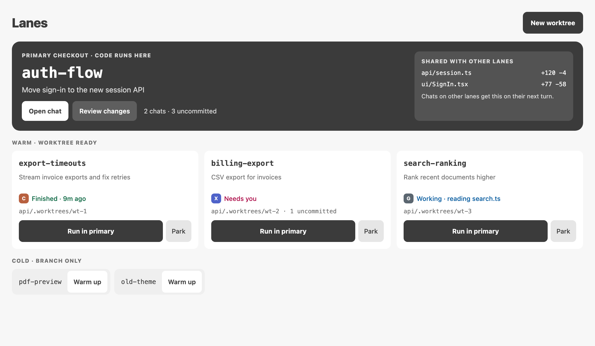

# Canopy

<p align="center">
  
</p>

**Multi-provider, multi-repo orchestration tool.**

Chat with coding agents — Claude, Codex, Grok, and any ACP agent — from one place in VS Code, on your own subscriptions.

Canopy runs each provider through its official CLI. It never reads, stores, or forwards your credentials, and it never calls provider APIs itself. Sign-in stays with each CLI.

You give the work to a lead. The lead captures the context of the task, and then delegates to other agents for research, implementation and review based on the providers you assign to each task type.



## Setup

Connect the CLIs you already use. Each one keeps its own sign-in.



Then say who does what: Research, Plan, Implement, and Review. A new chat is a group chat led by the roster's lead, so the lead can hand work across.

## Lanes

Lanes are that split across the repos in a lane. Agents do the work in worktrees, one slot in each repo that has the lane. The primary checkout of each of those repos is where you run the code. A lane is the same branch in every repo that has it, with one goal, plan, and set of notes. Warm lanes keep a worktree ready; cold lanes stay a branch until you warm them up. Bring a lane into the primary checkouts to run it, and its uncommitted work comes with it, across every repo in the lane, or not at all. Only one chat writes in a lane.



## What you can do

- Multi-repo lanes. The work happens in a worktree in each repo that has the lane. The primary checkout is where you run the code.
- Chats in the sidebar or in editor tabs. Sessions grouped by provider, then branch.
- Sessions that last. Close VS Code and continue. Fork a conversation or rewind to an earlier message.
- Streaming replies, reasoning, tool cards, nested subagent steps, diffs, plans, LaTeX, and Mermaid.
- Answer questions, review plans, and allow or deny actions from the chat.
- Model, permission mode, and reasoning effort. Steer a running turn, queue messages, and see context use.
- Notifications when a chat finishes, fails, or needs you.
- MCP servers: see each server's state and tools, and sign in from the chat.
- Colors come from the active VS Code theme.

## Requirements

- VS Code 1.106 or later.
- Claude: Claude Code installed and signed in (`claude auth status`).
- Codex: the Codex CLI, or the official Codex extension, signed in (`codex login status`).
- Grok: the Grok CLI from https://x.ai/cli, signed in with `grok login`.
- Cursor, OpenCode, and Gemini are also supported. `canopy.customAgents` adds other ACP agents.

## Install

Canopy is not on the Marketplace yet. Build and sideload it:

```sh
pnpm install
pnpm run package
code --install-extension canopy-0.1.0.vsix --force
```

Reload VS Code and open Canopy from the activity bar.

## Development

See [AGENTS.md](AGENTS.md) for commands, verification, and architecture links.
